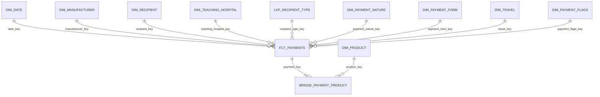

# Data-Modeling-Q3

Dimensional model (star schema) for the **CMS Open Payments – General Payments** dataset:
payments from pharmaceutical and medical-device manufacturers to physicians and teaching hospitals.

- **Engine:** PostgreSQL 16 (Docker)
- **Layers:** `raw_layer` (landed as-is, all TEXT) → `gold` (typed, cleaned, deduplicated star schema). No silver layer, per the program plan.
- **Scale:** 16,131,856 payment records, program year 2025.
- **Source:** [CMS Open Payments](https://openpaymentsdata.cms.gov/) general payments file.

## Star schema

One fact table, nine dimensions, one lookup and one bridge.



**Grain:** one row in `gold.fct_payments` = one published CMS payment record (`Record_ID`).
**Measures:** `total_payment_us_dollars`, `number_of_payments_included_in_total_amount`.

| Table | Purpose |
|---|---|
| `dim_date` | calendar |
| `dim_manufacturer` | paying manufacturer or GPO |
| `dim_recipient` | physicians and non-physician practitioners |
| `dim_teaching_hospital` | teaching hospitals (hospital payments have no physician) |
| `dim_payment_nature` / `dim_payment_form` | what the payment was for, and how it was paid |
| `dim_travel` | travel city, state and country |
| `dim_payment_flags` | junk dimension for the Yes/No indicator columns |
| `dim_product` | individual drugs, biologicals, devices and supplies |
| `lkp_recipient_type` | recipient type as it was on the payment |
| `bridge_payment_product` | payment → product (a payment can list up to five products) |

Each bridge row carries a `product_share` (1 ÷ number of products on the payment), so summing
`amount × product_share` splits a payment across its products without double counting.

Design notes and limitations: [docs/data_model.md](docs/data_model.md).

## Business questions

| # | Business question | KPI | Path |
|---|---|---|---|
| 1 | Which manufacturers make the highest payments to physicians? | Total payment by manufacturer | fact → `dim_manufacturer`, physicians only |
| 2 | Which physicians received the highest total payments? | Total payment by physician | fact → `dim_recipient` |
| 3 | What type of payment is most common? | Count and amount by nature of payment | fact → `dim_payment_nature` |
| 4 | Which states/cities have the highest activity? | Total payments by state/city | fact → `dim_recipient` / `dim_teaching_hospital` |
| 5 | What is the trend over time? | Monthly / quarterly trend | fact → `dim_date` |
| 6 | Which specialties receive the highest payments? | Total by specialty | fact → `dim_recipient` |
| 7 | Which drugs/products are linked to the highest payments? | Total by product | fact → bridge → `dim_product` |
| 8 | Which payment categories are rising or falling? | Q1 vs Q4 change by category | fact → `dim_payment_nature` + `dim_date` |

All eight are in [sql/analysis/business_questions.sql](sql/analysis/business_questions.sql).

## Repository layout

```
docker-compose.yml                       Postgres 16 service (port 5433)
docs/data_model.md                       model diagram, design notes, known limitations
sql/
├── raw/01_create_raw_table.sql          raw landing table (all TEXT)
├── gold/
│   ├── 01_create_gold_tables.sql        star-schema DDL (keys, constraints, indexes)
│   ├── 02_transform_and_load.sql        clean + deduplicate + load dimensions and fact
│   └── 03_product_bridge.sql            product dimension + payment→product bridge
├── analysis/business_questions.sql      the 8 KPI queries
└── diagram/star_schema_diagram.sql      MySQL-dialect script to redraw the model in drawSQL
```

## How to run

```bash
docker compose up -d                                   # Postgres on localhost:5433
PSQL="psql -h localhost -p 5433 -U postgres -d datamodeling -v ON_ERROR_STOP=1"

$PSQL -f sql/raw/01_create_raw_table.sql               # then load the CMS file into raw_layer.open_payments_general
$PSQL -f sql/gold/01_create_gold_tables.sql
$PSQL -f sql/gold/02_transform_and_load.sql
$PSQL -f sql/gold/03_product_bridge.sql
$PSQL -f sql/analysis/business_questions.sql
```

Scripts 02 and 03 rebuild their tables from the raw data on every run. The full load is heavy at 16M rows
(the product bridge alone writes about 19M rows), so expect it to take a while.
