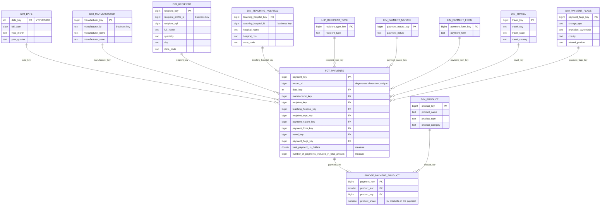

# Data model notes

## Diagram

Columns shown are keys and measures; see `sql/gold/01_create_gold_tables.sql` for the full definitions.
To redraw it in drawSQL, import [sql/diagram/star_schema_diagram.sql](../sql/diagram/star_schema_diagram.sql) (MySQL dialect).

## Grain and measures

One fact row is one CMS general-payment record (`Record_ID`): a single payment or transfer of value from one
manufacturer or GPO to one covered recipient on one date. Two additive measures: `total_payment_us_dollars`
and `number_of_payments_included_in_total_amount`. Use the second, not `count(*)`, when you need the number
of discrete payments (a record can aggregate several).

## Tables

Row counts include the placeholder rows.

| Table | Rows | Business key | Notes |
|---|---|---|---|
| `fct_payments` | 16,131,856 | `record_id` | Transaction fact |
| `dim_recipient` | 1,022,577 | `recipient_profile_id` | Physicians and non-physician practitioners |
| `dim_teaching_hospital` | 1,298 | `teaching_hospital_id` | Hospital payments |
| `dim_manufacturer` | 1,758 | `manufacturer_id` | |
| `dim_product` | 9,764 | `(product_type, product_name)` | One row per product type and name |
| `bridge_payment_product` | 19,465,411 | `(payment_key, product_slot)` | Payment → product with `product_share` |
| `dim_travel` | 9,295 | city / state / country | `N/A` row = no travel |
| `dim_payment_flags` | 102 | combination of indicators | Junk dimension |
| `dim_payment_nature` | 16 | `payment_nature` | |
| `dim_payment_form` | 6 | `payment_form` | |
| `lkp_recipient_type` | 3 | `recipient_type` | Recipient type as of the payment |
| `dim_date` | 6,575 | `date_key` (YYYYMMDD) | 2013-01-01 to 2030-12-31 |

## Keys and placeholder rows

Every dimension has a `GENERATED BY DEFAULT AS IDENTITY` surrogate key, and every foreign key on the fact
is `NOT NULL`. A hospital payment has no physician and a physician payment has no hospital, so
`dim_recipient` and `dim_teaching_hospital` carry `-1` (Unknown) and `-2` (Not applicable) members.
Date and manufacturer have a `-1` Unknown member. Travel, flags, nature, form and recipient type use an
`N/A` or `Unknown` row loaded from the data.

## Cleaning

The raw table is all text and is never modified. `sql/gold/02_stage_payments.sql` reads it once and writes two
staging tables, using plain SQL (`TRIM`, `NULLIF`, `INITCAP`, `UPPER`, `TO_DATE`, casts):

- `gold.stg_payments`: one row per payment, with blanks turned into NULL or `N/A`, dates parsed from
  `MM/DD/YYYY`, ids and amounts cast to numbers, and names and cities title-cased.
- `gold.stg_payment_products`: one row per payment and product, made by unpivoting the five product columns.

The load step then builds the dimensions from these tables. Where a dimension row appears on many payments,
the attributes from the most recently published payment are used.

The source data was checked first: every id, date and amount is well formed, there are no duplicate
`Record_ID` values, and the Yes/No indicators are already `Yes` or `No`, so no further repair or
deduplication is needed.

## Known limitations

1. **Single program year.** The data covers 2025 only, so question 8 compares the first and last quarter of
   the year per payment category rather than year over year.
2. **Money is `double precision`.** Totals can differ from exact decimal arithmetic by fractions of a cent;
   `numeric(14,2)` would be the safer choice for a money column. Bridge shares are rounded to 8 decimals,
   so a weighted product total can differ from the fact total by a few cents.
3. **Slowly changing data.** All dimensions are Type 1: each takes the attributes from the latest published
   record. The lookup `lkp_recipient_type` keeps the recipient type as it was on each payment.
4. **Outliers are real source data, not errors.** A few payments are very large (acquisitions, royalties),
   which dominates some rankings. Worth a note when presenting results.
5. **Identifier truncation.** Postgres caps identifiers at 63 characters, so two long raw column names are
   silently truncated. Queries work, but an explicit full-name column list or a port to another engine would break.
6. **Product names are as reported.** A product is identified by its type and name, so the category, NDC and PDI
   on `dim_product` come from its latest payment. Placeholder names such as `NA` or `N.A.` exist in the source
   and are kept as separate products.
7. **Not modelled:** the contextual free-text column, the third-party entity name, the recipient's separate
   first/middle/last name columns (only `full_name` is kept), address line 2, province, postal code and license state.
